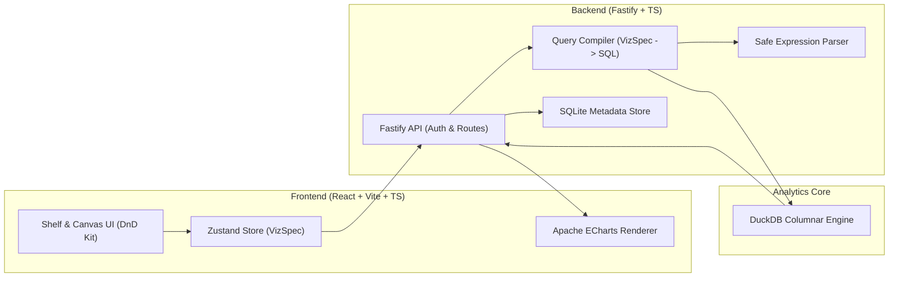

# Reverse Tableau 📊

> Open-source self-service Business Intelligence (BI) platform inspired by Tableau Desktop and Cloud. Built with React, TypeScript, Fastify, DuckDB, and Apache ECharts.


---

## 🌟 Overview

**Reverse Tableau** is a modern, web-native analytical tool designed to bring the intuitive drag-and-drop workflow of Tableau directly to the browser. It translates visual shelf interactions into optimized SQL queries via a declarative **VizQL-like query compiler**, executed directly against **DuckDB** for blazing-fast in-process analytics.

---

## ⚡ Key Features

### 1. 🗄️ Ingestion & Schema Detection
- **Instant CSV Upload**: Ingest and index raw tabular datasets directly into columnar DuckDB tables.
- **Smart Field Classification**: Columns are automatically categorized into:
  - 🔵 **Dimensions** (Categorical, Dates, Booleans, Strings)
  - 🟢 **Measures** (Numerical data: Integers, Decimals, Floats)
- **Data Preview**: Inspect real-time preview tables with raw schema metadata.

### 2. 🎛️ Tableau Shelf Interface
- **Columns & Rows Shelves**: Drag fields from the sidebar or double-click to place them onto visualization shelves.
- **Aggregations & Granularity**:
  - Measures support configurable aggregations: `SUM`, `AVG`, `COUNT`, `MIN`, `MAX`.
  - Date dimensions support instant truncation: `Year`, `Quarter`, `Month`, `Week`, `Day`.
- **Color Shelf**: Segment visualizations and create multi-series or grouped plots by dragging a categorical dimension onto the Color shelf.
- **Filters Shelf**:
  - Categorical checklist with real-time value search.
  - Continuous numeric range sliders / inputs (`min` to `max`).
  - Date range pickers (`from` to `to`).

### 3. 📈 Multi-Mark Visualization Engine
Powered by **Apache ECharts** with a clean, high-contrast light theme:
- **Auto**: Automatically resolves the best chart type based on shelf field signatures.
- **Bar Chart**: Vertical and horizontal bars with automatic series color grouping.
- **Line & Area Chart**: Smooth trend lines with time-series date parsing.
- **Scatter Plot**: Raw disaggregated measure-by-measure plots colored by category.
- **Pie / Donut Chart**: Proportional distribution with interactive percentage tooltips.
- **Treemap**: Hierarchical nested views across multiple dimension levels.
- **Heatmap**: 2D categorical density matrix with customizable gradient color ranges.

### 4. 🧮 Calculated Fields Engine
A custom recursive-descent expression parser that converts human-readable Tableau formulas into safe DuckDB SQL queries without exposing raw SQL or arbitrary code execution:
- **Arithmetic**: `[penjualan] * [qty]`
- **Logic & Branching**: `IF [penjualan] >= 30000 THEN "High" ELSEIF [penjualan] >= 15000 THEN "Medium" ELSE "Low" END`
- **String & Date Functions**: `UPPER([produk]) & "-" & YEAR([tanggal])`
- **Protected Math**: Division by zero is automatically guarded (`NULLIF`).
- **Layered Calculations**: Calculated fields can reference existing calculated fields seamlessly.

---

## 🏗️ Architecture



### Technology Stack
- **Frontend**: React 19, TypeScript, Vite, Apache ECharts, Zustand, `@dnd-kit/core`
- **Backend**: Fastify, TypeScript, DuckDB (`@duckdb/node-api`), Better-SQLite3, `@fastify/jwt`, `bcryptjs`
- **Styling**: Vanilla CSS design system with tailored HSL/Hex tokens, high-contrast palette, and responsive layout.

---

## 🚀 Getting Started

### Prerequisites
- **Node.js** >= 20.x
- **npm** >= 10.x

### 1. Clone the Repository
```bash
git clone https://github.com/barypratama1/reverse-tableau.git
cd reverse-tableau
```

### 2. Install Dependencies
```bash
# Install backend dependencies
cd server
npm install

# Install frontend dependencies
cd ../web
npm install
```

### 3. Start Development Servers

In terminal 1 (Backend):
```bash
cd server
npm run dev
# Server runs on http://localhost:4000
```

In terminal 2 (Frontend):
```bash
cd web
npm run dev
# Web app runs on http://localhost:5173
```

### 4. Try with Sample Data
1. Open `http://localhost:5173` in your browser.
2. Register a new user account (e.g. `user@example.com` / `password123`).
3. Click **"+ Unggah CSV"** and select the provided [`sample.csv`](sample.csv) in the root directory.
4. Double-click `kategori` to add it to **Columns**, and double-click `penjualan` to add it to **Rows**.
5. Switch chart types using the **Mark** toolbar (Bar, Line, Pie, Scatter, etc.).
6. Click **"ƒ Calculated Field"** to define custom metrics (e.g., `[penjualan] * [qty]`).

---

## 📁 Project Structure

```text
reverse-tableau/
├── sample.csv                 # Sample dataset for quick evaluation
├── server/                    # Fastify backend service
│   ├── src/
│   │   ├── index.ts           # API routes & JWT authentication
│   │   ├── db.ts              # SQLite metadata & DuckDB instance connection
│   │   ├── compiler.ts        # VizSpec to SQL query compiler
│   │   ├── datasource.ts      # Calculated-field layered source builder
│   │   └── expr.ts            # Safe calculated field expression parser
│   ├── package.json
│   └── tsconfig.json
├── web/                       # React frontend application
│   ├── src/
│   │   ├── App.tsx            # Main application router
│   │   ├── Auth.tsx           # Authentication screen
│   │   ├── Workspace.tsx      # Sidebar, tabs, and drag-and-drop context
│   │   ├── Worksheet.tsx      # Shelf system and mark selectors
│   │   ├── Chart.tsx          # Apache ECharts wrapper
│   │   ├── chartOption.ts     # ECharts options & chart resolution logic
│   │   ├── FilterEditor.tsx   # Discrete and continuous filter popovers
│   │   ├── CalcDialog.tsx     # Calculated field creation modal
│   │   ├── store.ts           # Zustand state management
│   │   ├── api.ts             # Typed API client
│   │   └── index.css          # Modern light-theme styling system
│   ├── package.json
│   └── vite.config.ts
├── .gitignore
└── README.md
```

---

## 🗺️ Roadmap
- [x] **Phase 1**: Authentication, multi-user workspace, CSV upload, DuckDB query execution, data preview.
- [x] **Phase 2**: Shelf drag-and-drop interface, VizQL compiler, dynamic aggregations, auto-mark resolver (Bar, Line, Area, Scatter).
- [x] **Phase 3**: Filters shelf, row-level calculated fields engine, new marks (Pie, Treemap, Heatmap), high-contrast light theme.
- [ ] **Phase 4**: Multi-worksheet Dashboard Builder with cross-chart interactive click filters.
- [ ] **Phase 5**: Direct external database connectors (PostgreSQL, MySQL, Snowflake).
- [ ] **Phase 6**: LOD (Level of Detail) expressions & Window Table Calculations.

---

## 📄 License
This project is open-source under the MIT License.
